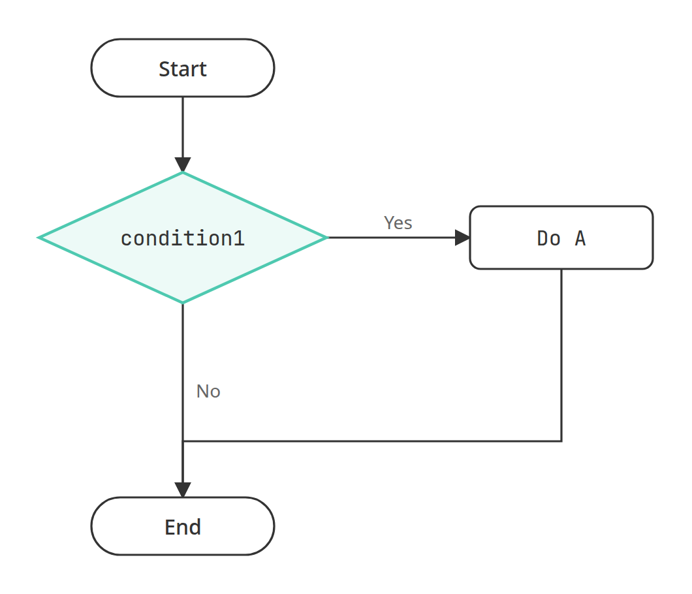
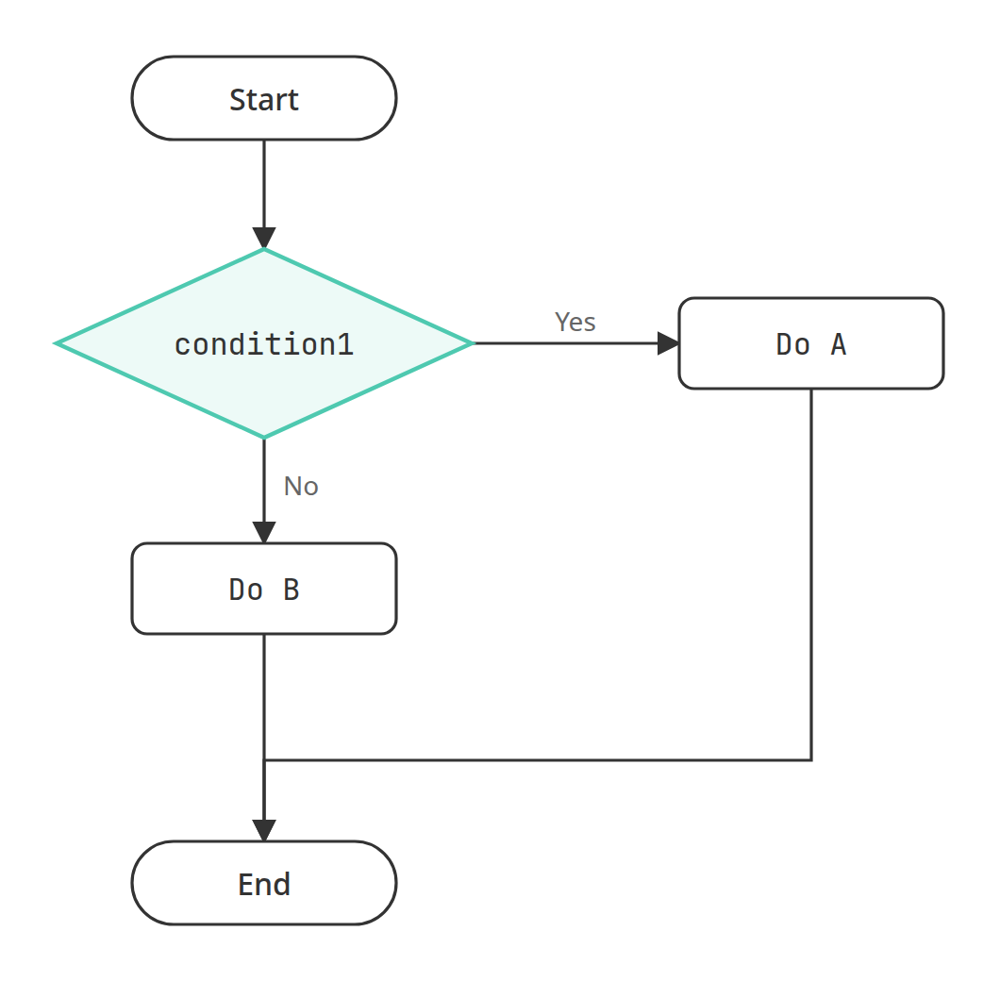
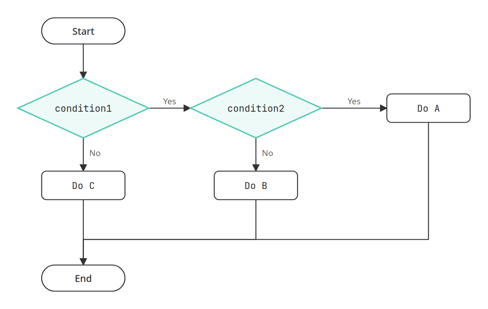
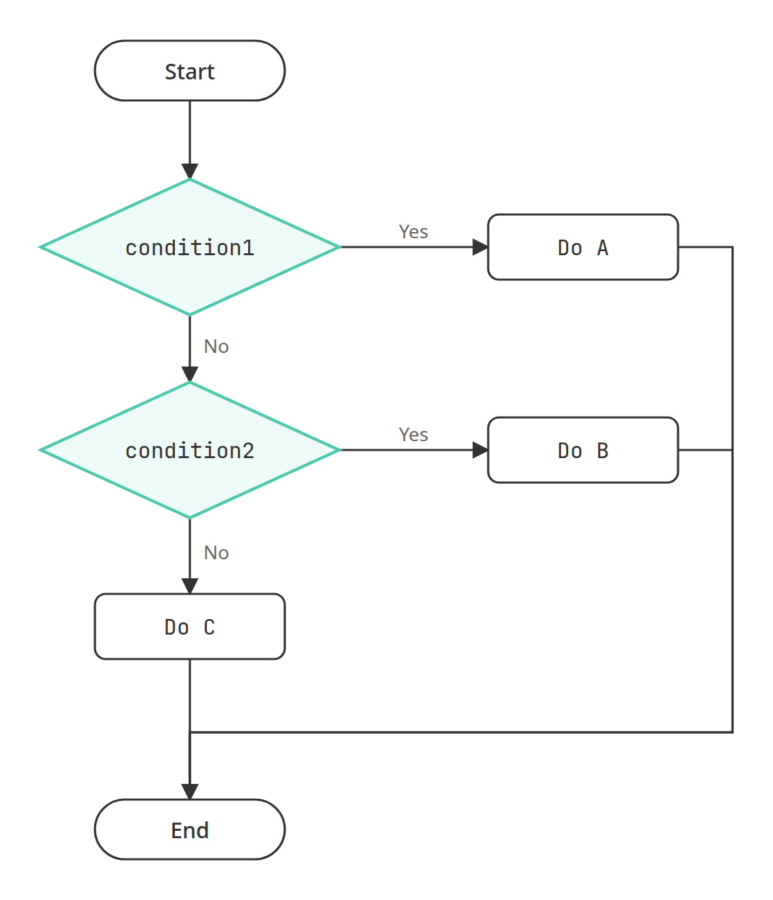

# if 流程控制

當我們的程式需要根據某些狀況做出判斷，例如某些條件成立的話，程式就對應做出某種行為，這時單純從頭執行到尾的程式便無法滿足我們的需求，因此便需引進流程控制的概念，也就是 if 敘述以及其相關的語法，來讓程式可以完成更複雜的工作。

## if 敘述

最基本 if 敘述語法如下，如果滿足 condition1 的條件判斷，則執行 A 程式碼區塊，否則就結束判斷。

```
if condition1:
    Do A
```



例如以下的程式，`is_raining` 是 `True`，所以會印出提醒帶傘的訊息：

```python
is_raining = True
if is_raining:
    print("Take an umbrella.")
print("Go out.")
```

執行結果：

```
Take an umbrella.
Go out.
```

### 縮排與冒號

上面的例子裡，`print("Take an umbrella.")` 前面空了 4 格，`print("Go out.")` 則沒有，這個差別是有意義的。Python 用縮排來決定哪幾行屬於 if 的程式碼區塊：縮排的那幾行只在條件成立時才執行，沒有縮排的 `print("Go out.")` 已經在 if 之外，不論條件是否成立都會執行。把 `is_raining` 改成 `False`，就只會印出「Go out.」。

縮排在 Python 是語法的一部分，習慣上用 4 個半形空白，同一個區塊裡的每一行縮排要一致。if 的那一行最後的冒號 `:` 也不能省略，它代表接下來是一個程式碼區塊。

如果忘了縮排：

```python
is_raining = True
if is_raining:
print("Take an umbrella.")
```

錯誤訊息的最後一行如下：

```
IndentationError: expected an indented block after 'if' statement on line 2
```

如果忘了冒號：

```python
is_raining = True
if is_raining
    print("Take an umbrella.")
```

錯誤訊息的最後一行如下：

```
SyntaxError: expected ':'
```

## if / else 敘述

進一步，如果滿足 condition1 的條件判斷時執行 A 程式碼區塊，不滿足時要執行 B 程式碼區塊，則可以用 if / else 敘述。

```
if condition1:
    Do A
else:
    Do B
```



## 巢狀 if 敘述

若 if 敘述裡面包含有其它的 if 敘述，稱為巢狀 if 敘述。

```
if condition1:
    if condition2:
        Do A
    else:
        Do B
else:
    Do C
```



## if / elif / else 敘述

當程式有多個條件要做判斷時，可使用 if / elif / else 敘述。

```
if condition1:
    Do A
elif condition2:
    Do B
......
else:
    Do C
```



例如，當我們要設計一個 BMI（Body Mass Index）的計算程式時，必須判斷[1]：

- 若 BMI 小於 18.5 時，體重過輕。
- 若 BMI 大於或等於 18.5、且 BMI 小於 24 時，體重正常。
- 若 BMI 大於或等於 24、且 BMI 小於 27 時，體重過重。
- 若 BMI 大於或等於 27 時，則達到肥胖的程度。

此時除了必須運用 if / elif / else 語法外，還需引入關係運算子與邏輯運算子的觀念。

## 關係運算子

- `a > b`：檢查 a 是否大於 b
- `a >= b`：檢查 a 是否大於或等於 b
- `a < b`：檢查 a 是否小於 b
- `a <= b`：檢查 a 是否小於或等於 b
- `a == b`：檢查 a 是否等於 b
- `a != b`：檢查 a 是否不等於 b

舉例來說：

```python
# a > b
print(2 > 1)
print(1 > 2)
```

```python
# a >= b
print(2 >= 2)
print(1 >= 2)
```

```python
# a < b
print(1 < 2)
print(2 < 1)
```

```python
# a <= b
print(2 <= 2)
print(2 <= 1)
```

```python
# a == b
print(2 == 2)
print(2 == 1)
```

```python
# a != b
print(2 != 1)
print(2 != 2)
```

執行結果：

```
True
False
True
False
True
False
True
False
True
False
True
False
```

### `==` 和 `=` 不一樣

要注意檢查是否相等用的是兩個等號 `==`，一個等號 `=` 是把值指派給變數。在 if 的條件裡寫成一個等號，會產生錯誤：

```python
x = 1
if x = 1:
    print("x is 1")
```

錯誤訊息的最後一行如下：

```
SyntaxError: invalid syntax. Maybe you meant '==' or ':=' instead of '='?
```

Python 猜我們想寫的是 `==`，另一個選項 `:=` 是指派運算式（assignment expression），本系列不會用到。

## 邏輯運算子

- `and` 運算子，例如：`condition1 and condition2`，兩條件必須同時成立為 `True`，反之為 `False`。
- `or` 運算子，例如：`condition1 or condition2`，兩條件至少有一個成立為 `True`，反之為 `False`。
- `not` 運算子，例如：`not condition1`，此條件不成立為 `True`，反之為 `False`。

舉例來說：

```python
# and
print((1 < 2) and (2 < 3))
print((1 < 2) and (3 < 2))
```

```python
# or
print((1 < 2) or (3 < 2))
print((2 < 1) or (3 < 2))
```

```python
# not
print(not (1 > 2))
print(not (1 < 2))
```

執行結果：

```
True
False
True
False
True
False
```

### 連鎖比較

前面 BMI 正常範圍的條件「大於或等於 18.5、且小於 24」，用 `and` 可以寫成 `bmi >= 18.5 and bmi < 24`。Python 也允許把兩個比較直接串在一起，寫成跟數學一樣的 `18.5 <= bmi < 24`，兩種寫法的結果相同：

```python
bmi = 23.1
print(bmi >= 18.5 and bmi < 24)
print(18.5 <= bmi < 24)
```

執行結果：

```
True
True
```

## 實作 BMI 計算機

綜合以上所學，這個程式會要求使用者輸入身高和體重，接著計算 BMI，然後回傳它所計算的數值並判斷體重是否在正常範圍內。

```python
# input your height and weight
height = float(input("Please input your height in centimeter:\n"))
weight = float(input("Please input your weight in kilogram:\n"))

# calculate BMI
bmi = weight / ((height / 100) ** 2)

# BMI interpretation
if bmi < 18.5:
    print(f"Your BMI is {bmi}, and you are underweight.")
elif bmi < 24:
    print(f"Your BMI is {bmi}, and you have a normal weight.")
elif bmi < 27:
    print(f"Your BMI is {bmi}, and you are overweight.")
else:
    print(f"Your BMI is {bmi}, and you are obese.")
```

以下是執行結果：

```
Please input your height in centimeter:
180
Please input your weight in kilogram:
75
Your BMI is 23.148148148148145, and you have a normal weight.
```

身高和體重用 `float()` 轉換，是因為使用者可能輸入「175.5」這種帶小數點的數字，用 `int()` 轉換會產生 `ValueError`。

注意程式裡第二個條件只寫了 `bmi < 24`，沒有寫 `bmi >= 18.5`。這是因為 if / elif / else 會由上往下逐一判斷，遇到第一個成立的條件，就執行它底下的區塊，其餘的條件都會跳過不再判斷。能走到 `elif bmi < 24` 這一行，代表前面的 `bmi < 18.5` 已經不成立，也就是 BMI 一定大於或等於 18.5，所以下限不必再寫一次。也因為如此，條件的先後順序會影響結果，把範圍由小到大依序排好，程式才會判斷正確。

---

這一章我們學會了用 if、if / else、巢狀 if 與 if / elif / else 讓程式依條件走不同的路，也認識了關係運算子與邏輯運算子。Python 用縮排決定哪些程式碼屬於同一個區塊，遇到 `IndentationError` 或 `SyntaxError` 時，可以先檢查縮排、冒號，以及比較時是不是少寫了一個等號。

## 本章程式碼

- [GitHub](./code/) — 本章所有可執行範例
<!-- only:github,web -->
- [在 Colab 開啟](https://colab.research.google.com/github/wjweng/python-notes/blob/main/notebooks/04-conditionals.ipynb) — 用 Google 帳號登入就能執行，可以複製一份留在自己的雲端硬碟
<!-- /only -->
<!-- only:github,colab -->
- [在瀏覽器直接執行](https://wjweng.github.io/python-notes/web/04-conditionals.html) — 不用登入，開啟就能改程式碼看結果
<!-- /only -->

## 參考資料

[1] [衛生福利部：肥胖是慢性疾病！調整飲食及運動生活是最佳處方](https://www.mohw.gov.tw/cp-3796-42429-1.html)
